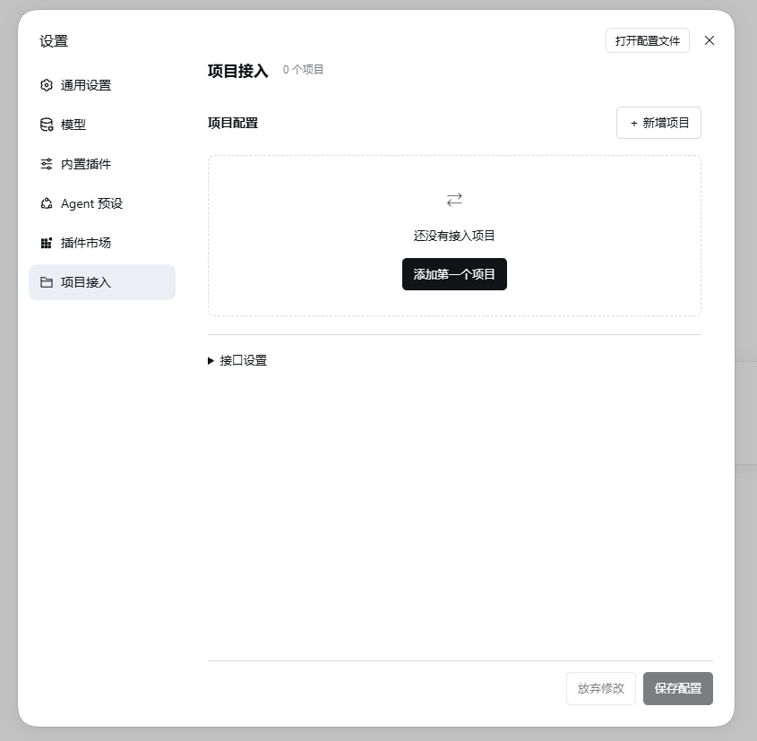

terms-bridge 是 DeepSeek Harness（dsh）的项目接入插件，用来连接业务项目与 dsh。业务项目提交提示词和文件，插件在对应工作区内创建或续接原生会话执行任务，并将 AI 的最终回复和结果文件引用回传给项目。

<p align="center">
  
</p>

## 安装（推荐 npm）

需要 Node.js 22.13+ 和兼容的 dsh；已验证 dsh `0.2.1-rc.2`。推荐从 [npm](https://www.npmjs.com/package/@fevolq/terms-bridge) 安装，以下使用 Web profile：

```powershell
dsh plugin --profile web add @fevolq/terms-bridge
```

已安装时，更新到最新版本：

```powershell
dsh plugin --profile web update @fevolq/terms-bridge --latest
```

请将 `web` 替换为实际使用的 profile。安装或更新后，重启对应的 dsh 实例以加载新代码，再进入「设置 → 项目接入」配置项目。

本地安装、源码构建、项目配置和接口协议见[使用说明](docs/usage.md)，可运行的接入示例见 [examples](examples)。

## 功能与用途

适用于资料分析、文本整理、报告生成，以及通过 dsh 已有技能完成图片生成、图片编辑等业务。具体任务由项目传入的提示词决定，执行能力来自所在 dsh 的模型、工具和技能。

| 功能 | 说明 |
| --- | --- |
| 多项目接入 | 每个项目拥有独立工作区及任务会话，支持单独配置模型、Agent 预设、权限和回调 |
| 多轮对话 | 同项目、同会话 ID 续接同一原生会话，上下文由 dsh 管理；每次新对话使用新的 chat_id |
| 原生设置集成 | 在 dsh 的「项目接入」页面管理项目，从已配置的模型和 Agent 预设中选择 |
| SQLite 存储 | 插件配置、工作区绑定、session 映射和任务交付数据保存在当前 profile 的 SQLite 数据库中 |
| 配置热更新 | 项目配置保存后生效，已有任务沿用接收时的配置；调整并发不会中断正在执行的任务 |
| 文件传输 | 支持上传输入文件、在提示词中引用文件，以及下载最终结果文件 |
| 任务调度 | 支持不限并发或按项目限制并发，多余任务按顺序排队 |
| 执行重试 | 失败后按配置在原会话中重试，保持相同 chat_id；成功或重试耗尽后允许下一次对话 |
| 结果回传 | 回传最终助手回复原文及结果文件，支持 dsh 文件卡片；正文排除工具响应和推理内容 |
| 回调重试 | 回调失败后重发已保存的结果，不重新执行业务 |
| 状态查询与恢复 | 可查询执行和回调状态，重启后继续处理队列及剩余重试 |
| 项目鉴权 | 支持可选请求令牌和自定义回调请求头，适配不同业务项目 |

## 工作流程

业务项目提交任务 → 插件识别项目和会话并排队 → 在项目工作区创建或恢复 dsh 会话 → 使用指定模型、预设和权限执行 → 保存最终回复及结果文件 → 异步回调业务项目。

同一会话有未结束的对话时，新对话返回 `409 / CONVERSATION_BUSY`；已受理的 chat_id 再次提交一律返回 `409 / CHAT_ALREADY_EXISTS`。回调及其重试不阻塞后续对话。

本次回复和结果文件保存完成后，任务即为 `completed`。有输入文件时先上传，再随任务引用；任务完成后，通过结果文件 ID 下载文件。

## 与 dsh 的关系

插件维护业务会话与原生会话的映射，通过 dsh 接口创建或恢复会话、查询 Agent 状态和发送消息。上下文、预设恢复及 Agent 生命周期由 dsh 管理；会话创建后固定使用原有预设。插件负责任务状态、结果文件和异步回调，插件配置、工作区绑定、session 映射、任务交付记录及文件元数据保存在当前 dsh profile 的 `data/terms-bridge.sqlite` 中。会话消息和上下文仍由 dsh 原生存储管理，文件实体留在项目工作区。首次启动使用空配置，不迁移旧数据，也不扫描工作区已有文件；请在「项目接入」页面添加项目。
